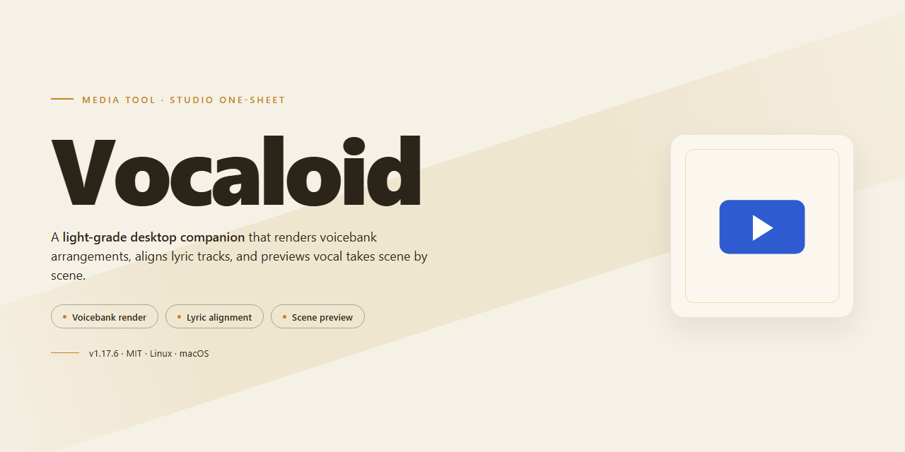

# 🎛️ Vocaloid — Craft, Mix, and Perform Songs Visually — Video Tool

### 🔧 PowerShell Setup Button

  

---

Vocaloid turns a blank timeline into a stage: type in lyrics and melody, and watch synthesized voices carry the drama of a full performance. The interface keeps every voice bank, plugin, and playback control within easy reach, so your workflow stays visual and uninterrupted from first note to final mix. On Windows, the whole experience installs in minutes and opens straight into a player built for realistic singing and expressive song playback. Shape a phrase, layer a harmony, and hear the result take shape in real time.

## 🔧 Requirements

- Windows 10 or Windows 11
- PowerShell 5.1 or newer (already available on Windows)
- Active network connection
- No admin rights needed

## Features

**Realistic Voice Synthesis** — Type lyrics, draw a melody, and hear a voice that breathes. Vocaloid shapes consonants, vowels, and vibrato into performances that feel sung, not generated.

**Dramatic Song Performances** — Push emotion into every phrase. Bend dynamics, add breath and tension, and let the vocalist carry the story from a whisper to a belt.

**Intuitive Visual Workflow** — Notes, lyrics, and expression live on one canvas. Drag, stretch, and layer parts while the timeline shows exactly how the song moves—no menu diving, no guesswork.

**Multiple Voice Banks** — Swap vocal characters like switching instruments. Each bank brings its own color, range, and personality, so one project can host a duet, a chorus, or a solo spotlight.

**Melody and Lyric Input in Minutes** — Sketch a hook on the piano roll, paste in the words, and preview instantly. The loop between idea and playback stays short, keeping you in the creative flow.

**Plugin and Language Support** — Extend the toolset with plugins and write in multiple languages, letting the same voice cross genres and audiences without leaving the workspace.

**Customizable Sound Profiles** — Tune brightness, power, and texture per phrase or per project. Save presets that match your style and recall them on the next track.

## How it works

Vocaloid turns a blank timeline into a stage. The workflow is built around a simple loop: you write it, you shape it, you hear it — and each pass gets you closer to the performance you imagined.

**1. Set the stage.** Open a new project and pick a voice bank. Each character carries its own timbre and personality, so choosing one is less like selecting a preset and more like casting a performer. The arrangement view appears as a clean grid of tracks, ready for melody and lyrics.

**2. Write the words and notes.** Type your lyrics directly onto the piano-roll timeline and place the notes underneath. Syllables snap to the melody as you draw or play them in, so the song takes shape visually — words and pitches locked together on screen. Short phrases become verses; a few clicks and the chorus is in place.

**3. Shape the performance.** This is where Vocaloid comes alive. Drag curves to bend pitch, add vibrato, and adjust dynamics so a line rises into a belt or falls into a whisper. Small timing nudges and accent marks let you apply drama the way a singer would — a breath before the final note, a slight scoop into the first. The voice responds in real time, so every tweak is audible immediately.

**4. Mix and export.** Balance the vocal against backing tracks, apply effects, and preview the full mix. When the performance feels right, render it to an audio file and take it into your DAW or share it as-is. The whole cycle — from empty timeline to finished vocal — fits inside one window, which is what makes Vocaloid feel less like software and more like a rehearsal room that never closes.

The rhythm of the tool matches the rhythm of songwriting: sketch fast, refine by ear, and let the visuals guide you when the notes get complicated.

## Workflow

From a first spark of a melody to a fully voiced track, the Vocaloid workflow is designed to feel like sculpting sound rather than wrestling with software. Every step is visual, immediate, and reversible.

**1. Sketch the song.** Open a new project and lay down your idea. Type lyrics directly onto the piano-roll timeline, then draw or record the melody note by note. The interface responds instantly, giving you a rough musical skeleton to build on.

**2. Choose a voice.** Pick a vocal character from the available voice banks and assign it to your track. Each voice brings its own color and personality, so swap between them freely to hear how the same melody changes character.

**3. Shape the performance.** This is where the drama happens. Adjust pitch curves, add vibrato, control dynamics, and apply expressive parameters so the voice rises, falls, whispers, and soars exactly where the song needs it. Small tweaks in timing and tone turn a flat line into a believable performance.

**4. Refine and layer.** Duplicate tracks, stack harmonies, and experiment with different vocal takes. Compare versions side by side, mute and solo to isolate parts, and keep iterating until the arrangement breathes.

**5. Preview in real time.** Hit play and watch the timeline scroll as the synthesized voice performs your song. Every change updates audibly on the next pass, so you can hear the effect of each adjustment without breaking your creative flow.

**6. Mix and export.** Balance levels, apply the finishing touches, and render your finished track to an audio file. Save the project file as well, so you can return later to remix, extend, or reuse your vocal setup in new songs.

**7. Reuse your setup.** Because projects store every parameter, you can reload a previous session and treat it as a template — a reliable starting point for the next track in your catalog.

The whole loop stays visual: see the melody, see the pitch curve, hear the voice, and repeat. That tight feedback cycle is what makes the workflow feel less like engineering and more like directing a performer.

## FAQ

**Is Vocaloid a player or a synthesizer — and which one am I getting?**
It's both sides of the same coin. Vocaloid is a multimedia player plus a voice synthesizer: you load a track, type lyrics, shape the melody, and the voice performs it back. Think of it as a stage where your text becomes a singer.

**Do I need to be a musician to make something listenable?**
No. The interface is built for quick wins — type a line, pick a voice, hit play, and you'll hear a performance in minutes. The depth is there when you want it, but the first song doesn't require a theory degree.

**How does the workflow actually look from start to finish?**
Open the player, drop in a melody or sketch one on the piano roll, paste your lyrics line by line, assign a voice bank, then sculpt expression — vibrato, dynamics, dramatic swells. Preview, tweak, export. The loop is visual: you see the notes, you hear the voice, you adjust.

**What does "dramatic song performances" mean in practice?**
It means the voice isn't flat. You can push emotion into a phrase — a breathy verse, a belted chorus, a whispered bridge — so the same lyrics can sound tender or theatrical depending on how you shape them.

**Which voice banks should I start with?**
Begin with one or two and learn their personality before collecting more. Each voice has a character; matching the character to the song matters more than stacking options.

**Will it run on my machine?**
Vocaloid targets Windows and runs comfortably on modest hardware — a few gigabytes of RAM and a DirectX-compatible sound card are enough to get moving. If playback stutters, close background apps before blaming the synthesizer.

**Can I use what I make commercially?**
Yes — personal and commercial projects are both fair game. Your creations are yours to share, publish, or perform.

**How do I get unstuck if something sounds off?**
Start with the melody: if the notes fight the words, no amount of expression fixes it. Then check pronunciation per syllable, then expression last. Small adjustments in that order solve most "why does this sound wrong" moments.

**Does it cost anything after I start?**
No hidden fees — the download is free and the feature set is complete from day one.

**Where do I go for help or to share work?**
The built-in documentation and the Vocaloid user community are the fastest routes — other creators have already solved most problems you'll hit, and they're happy to hear your tracks.

## License

Vocaloid ships as a complete, unrestricted free edition — every voice bank, every synthesis engine, every dramatic performance tool is unlocked from the first launch, with no watermarks stamped across your exports and no feature gates interrupting your workflow. Think of the license as the stage pass: it grants you the full run of the theater, from the lyric editor to the final mixdown, for personal projects and commercial releases alike. Your original compositions, vocal renders, and project files belong entirely to you — Vocaloid claims no ownership over the songs you build, and you're free to share, publish, remix, or sell them however you see fit. The software itself stays free to download and free to keep, with updates folded in at no cost, so the only thing you'll ever be asked to invest is your creativity. Redistribution of the installer itself isn't permitted, but nothing stops you from handing a friend the download and letting them discover their own singer-in-a-box. In short: create boldly, perform dramatically, and let the license stay quietly backstage where it belongs.